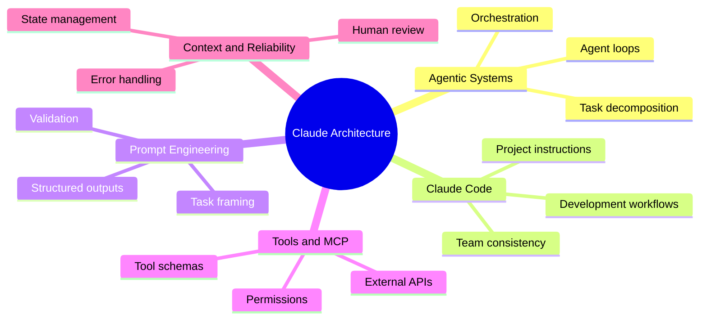
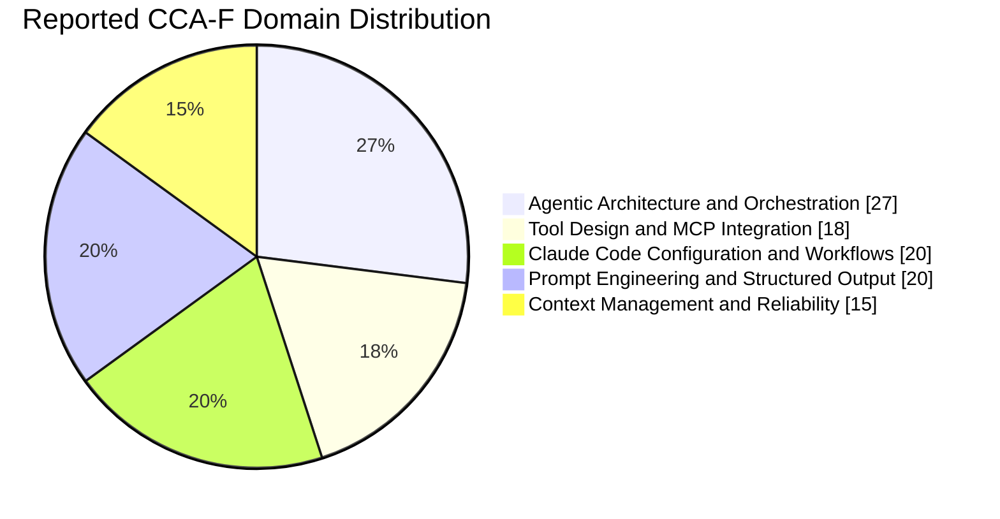
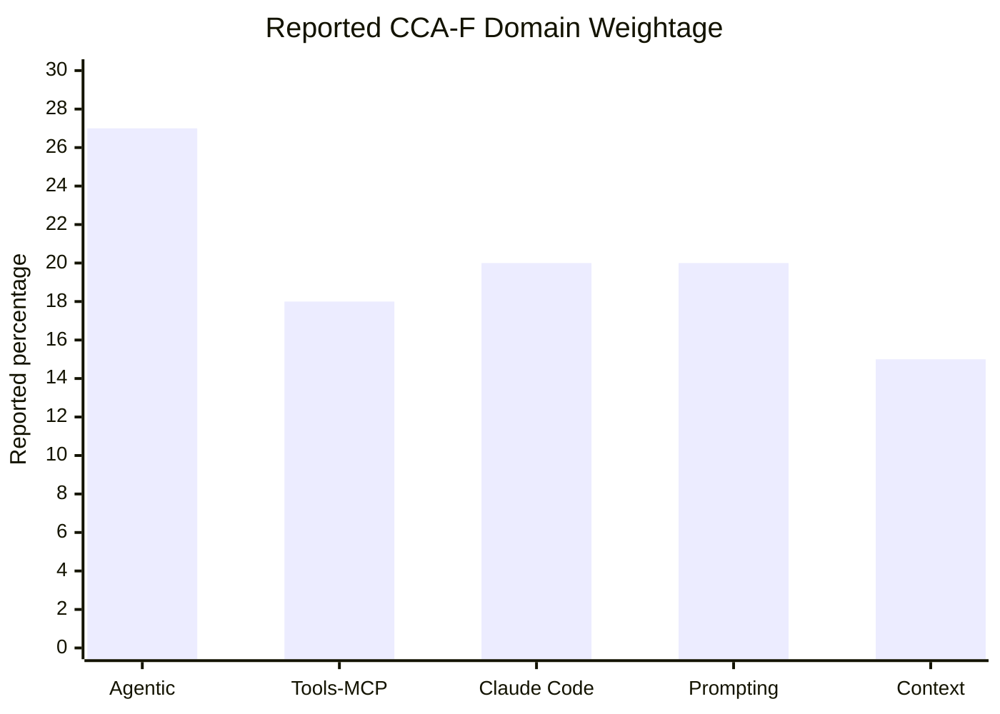
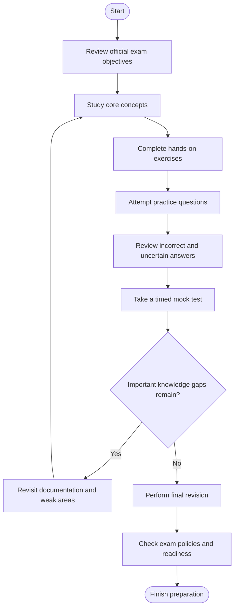
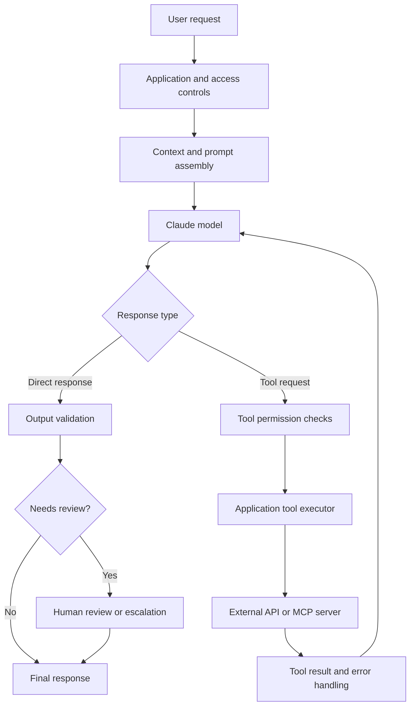
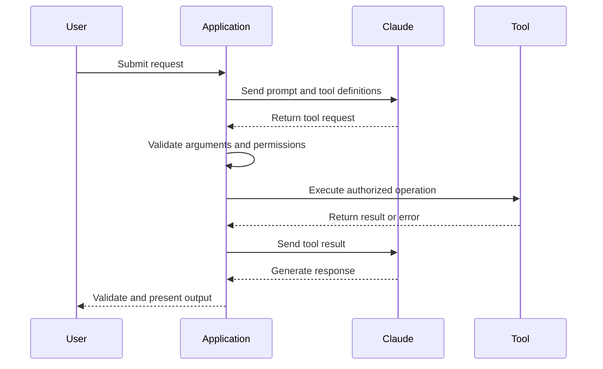
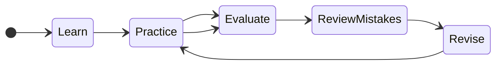
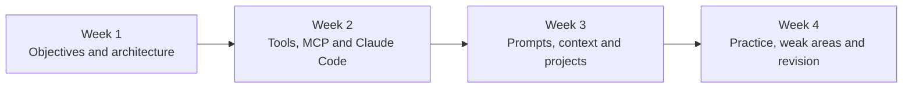

# Claude Certified Architect – Foundations (CCAR-F) Study Guide

A practical, community-maintained study guide for the **Claude Certified Architect – Foundations** certification from Anthropic. This repository organizes the technical concepts, architectural decisions, exercises, and revision strategies that learners can use to prepare for the exam.

The guide focuses on building reliable Claude-powered applications, designing agentic workflows, configuring Claude Code, integrating tools through the Model Context Protocol (MCP), engineering structured outputs, and managing context.

> **Exam code note:** CCAR-F is the official exam code reported in the published exam guide. CCA-F is a widely used alternative abbreviation and is used in the CertsGate exam listing linked below. Confirm the current code and requirements in Anthropic's official certification materials before registering.

- **Certification:** Claude Certified Architect – Foundations
- **Exam code:** CCAR-F (also commonly called CCA-F)
- **Provider:** Anthropic
- **Level:** Foundations
- **Study approach:** Official documentation, architectural practice, scenario analysis, and targeted revision
- **Supplementary resource:** [CertsGate CCA-F preparation page](https://certsgate.com/exams/anthropic/CCA-F)

This is an independent educational resource, not an official Anthropic publication.

---

## Table of Contents

- [1. About the Certification](#1-about-the-certification)
- [2. Who Should Prepare?](#2-who-should-prepare)
- [3. Exam Information](#3-exam-information)
- [4. Skills and Knowledge Areas](#4-skills-and-knowledge-areas)
- [5. Official Exam Objectives](#5-official-exam-objectives)
- [6. Domain Weightage and Study Priorities](#6-domain-weightage-and-study-priorities)
- [7. Certification Preparation Flowchart](#7-certification-preparation-flowchart)
- [8. Claude Application Architecture](#8-claude-application-architecture)
- [9. Circular Study and Revision Cycle](#9-circular-study-and-revision-cycle)
- [10. Step-by-Step Preparation Guide](#10-step-by-step-preparation-guide)
- [11. Recommended Study Schedule](#11-recommended-study-schedule)
- [12. Practice Questions and Mock Tests](#12-practice-questions-and-mock-tests)
- [13. Hands-On Labs and Projects](#13-hands-on-labs-and-projects)
- [14. Common Preparation Mistakes](#14-common-preparation-mistakes)
- [15. Career Relevance](#15-career-relevance)
- [16. Frequently Asked Questions](#16-frequently-asked-questions)
- [17. Official and Additional Learning Resources](#17-official-and-additional-learning-resources)
- [18. About CertsGate](#18-about-certsgate)
- [19. Disclaimer](#19-disclaimer)

---

## 1. About the Certification

The Claude Certified Architect – Foundations certification is intended for professionals who design and build applications using Claude. Anthropic introduced this technical certification for solution architects working on production applications.

Preparing for this certification involves more than learning API terminology. Architects must understand how an application coordinates model responses, tool execution, external systems, application state, and validation. They also need to recognize trade-offs involving reliability, maintainability, security, and output quality.

For example, a customer-support agent may need to retrieve an order, check a refund policy, and escalate an exceptional case. A useful architecture must determine which tools are appropriate, how their results return to Claude, and when the application should stop or request human assistance.

**Official announcement:** [Anthropic Claude Partner Network](https://www.anthropic.com/news/claude-partner-network)

## 2. Who Should Prepare?

This study guide is particularly relevant to:

- Software engineers developing applications with Claude.
- AI engineers building tool-using agents and multi-step workflows.
- Solution architects evaluating agent architecture and integration patterns.
- Developers using Claude Code in individual or team workflows.
- Technical professionals interested in MCP, structured outputs, and context management.

A basic understanding of APIs, application development, JSON, and software integration is a useful starting point. Practical experience building or maintaining an application will make architectural trade-offs easier to understand.

If you are completely new to application development, learn the underlying programming and API concepts before moving into complex agentic workflows.

## 3. Exam Information

The following table summarizes information reported in published CCA-F exam guides. These details should be checked against Anthropic's current exam guide and registration instructions before scheduling.

| Item | Reported information |
|---|---|
| Certification | Claude Certified Architect – Foundations |
| Official exam code | CCAR-F |
| Common alternative name | CCA-F |
| Provider | Anthropic |
| Question count | 60 |
| Time limit | 120 minutes |
| Question format | Multiple-choice and multiple-response |
| Reported passing score | 720 on a scaled 100–1,000 scale |
| Delivery | Proctored delivery; verify current Pearson VUE options |
| Primary focus | Claude application architecture and implementation decisions |

The question count, time limit, scoring policy, price, delivery method, and other exam rules can change. Consult the current official materials rather than relying solely on third-party summaries.

**Registration and policy starting points:**

- [Anthropic official website](https://www.anthropic.com/)
- [Anthropic certification announcement](https://www.anthropic.com/news/claude-partner-network)
- [Pearson VUE](https://www.pearsonvue.com/)

## 4. Skills and Knowledge Areas

The preparation process should connect technical concepts with real implementation decisions.

| Knowledge area | What to understand | Practical example |
|---|---|---|
| Agentic architecture | Agent loops, orchestration, task decomposition, and stopping conditions | Build an agent that investigates a request and stops when its objective is met |
| Claude Code | Project instructions, workflows, commands, and development practices | Configure consistent instructions for a team repository |
| Prompt engineering | Task framing, constraints, examples, and structured outputs | Extract validated fields from an incoming support request |
| Tool design and MCP | Tool descriptions, input schemas, permissions, and external integrations | Let an agent retrieve an order through a narrowly scoped tool |
| Context management | Context selection, conversation state, long-running tasks, and reliability | Summarize a long investigation while retaining essential evidence |

These are study areas, not a substitute for the provider's exact objective statements.

### Independent skills map

The following map groups related concepts for learning. It is a conceptual study overview, not an official exam-weighting chart.

## 5. Official Exam Objectives

Start with the current exam guide rather than assuming that a third-party topic list represents the complete blueprint.

The published CCA-F blueprint has been described using five principal domains:

1. Agentic Architecture and Orchestration.
2. Tool Design and MCP Integration.
3. Claude Code Configuration and Workflows.
4. Prompt Engineering and Structured Output.
5. Context Management and Reliability.

Use the official guide to confirm the exact domain titles, task statements, version, and any changes to their scope.

For each objective, maintain a checklist containing:

- The concept and its purpose.
- The relevant official documentation.
- A small implementation exercise.
- Potential failure modes and architectural trade-offs.
- Questions you answered incorrectly or could not explain confidently.

### Example objective-tracking table

| Study area | Evidence of understanding | Status |
|---|---|---|
| Agent orchestration | Explain when an agent should continue, stop, or hand off work | To assess |
| Tool integration | Implement a tool call and process its result safely | To assess |
| Claude Code | Configure project-level instructions and test the workflow | To assess |
| Structured output | Validate a response against a defined schema | To assess |
| Context reliability | Handle missing information and preserve relevant state | To assess |

Update this checklist using the actual objectives in the latest official exam guide.

## 6. Domain Weightage and Study Priorities

Published independent exam-preparation guides report the following approximate distribution for the five CCA-F domains. The percentages below should be cross-checked against the latest official exam guide before being treated as the current blueprint.

| Domain | Reported weight |
|---|---:|
| Agentic Architecture and Orchestration | 27% |
| Tool Design and MCP Integration | 18% |
| Claude Code Configuration and Workflows | 20% |
| Prompt Engineering and Structured Output | 20% |
| Context Management and Reliability | 15% |

### Reported domain distribution

The following charts visualize the reported percentages above; they are not an independent verification of the current official blueprint.

**How to use the chart:** If these percentages match the current official blueprint, allocate more study time to higher-weight domains without ignoring smaller domains. Combine percentage-based planning with your own diagnostic results. A domain where you consistently make mistakes may require additional attention regardless of its weight.

If Anthropic publishes a revised blueprint, update both charts and the table together.

## 7. Certification Preparation Flowchart

Use this workflow to turn the exam objectives into measurable learning activities. Readiness should be based on demonstrated understanding, not simply the number of questions completed.

This is a recommended study workflow, not an official Anthropic process.

## 8. Claude Application Architecture

A typical Claude-powered application connects a model to application logic, optional external tools, and a validation layer. The exact architecture depends on the product and the interfaces supported by the chosen Claude platform.

The diagram below illustrates a conceptual tool-using application. It is not a prescribed exam architecture.

### Important architecture concepts

**Application boundary:** Your application remains responsible for authentication, authorization, business rules, and execution of client-side tools.

**Tool execution:** A model-generated tool request is not the same as an executed operation. The application must validate arguments, enforce permissions, run the tool, and return an appropriate result.

**MCP integration:** The Model Context Protocol provides a standardized way to connect compatible applications with tools and other contextual capabilities. Understand how server configuration, authentication, tool discovery, and error handling fit into your design.

**Output validation:** Even when a response follows a structured schema, validate the content against business requirements before using it for consequential actions.

**Reliability:** Define timeouts, retry policies, stopping conditions, logging, and human escalation where appropriate. A workflow that produces a plausible response is not necessarily a reliable production system.

### Tool-call sequence

This sequence illustrates the request-and-result cycle used by an application that executes client-side tools.

For implementation details, consult the [official tool-use documentation](https://platform.claude.com/docs/en/agents-and-tools/tool-use/overview).

## 9. Circular Study and Revision Cycle

Technical preparation works best as a repeated cycle. Reading a topic once does not establish that you can apply it to an unfamiliar architecture scenario.

Repeat the cycle for each important objective:

1. Learn the concept from official documentation.
2. Implement or explain it in a practical example.
3. Evaluate your understanding using original practice questions.
4. Review mistakes and uncertain decisions.
5. Revise the underlying concept.
6. Attempt a new problem that tests the same skill in a different context.

The goal is to improve reasoning, not to memorize a fixed collection of answers.

## 10. Step-by-Step Preparation Guide

### Step 1: Establish your baseline

Read the exam guide and list its objectives. Mark each one as unfamiliar, partially understood, or comfortable. Be honest about practical experience with agentic systems and integrations.

### Step 2: Learn agentic architecture

Understand the relationship between model responses, tool calls, tool results, and stopping conditions. Practice deciding when a single-agent workflow is sufficient and when additional orchestration would introduce unnecessary complexity.

### Step 3: Practice tool design and MCP

Design narrowly scoped tools with descriptive names and clear input schemas. Explore authentication, permission boundaries, tool failures, and how external results are returned to the application.

Official reading: [Tool use with Claude](https://platform.claude.com/docs/en/agents-and-tools/tool-use/overview) and [MCP connector documentation](https://platform.claude.com/docs/en/agents-and-tools/mcp-connector).

### Step 4: Configure Claude Code workflows

Explore project instructions, repeatable development tasks, and team conventions. Practice making repository instructions specific enough to be useful without creating conflicting or unnecessarily restrictive rules.

Official documentation: [Claude Code documentation](https://code.claude.com/docs/en/overview).

### Step 5: Improve prompts and structured outputs

Practice turning ambiguous requests into clear tasks with explicit constraints. When machine-readable output is required, define the expected structure and validate it before downstream processing.

Official documentation: [Structured outputs](https://platform.claude.com/docs/en/build-with-claude/structured-outputs).

### Step 6: Manage context and reliability

Study how relevant context is supplied, how long-running work retains necessary information, and how applications recover from missing or invalid tool results. Test edge cases instead of evaluating only successful requests.

### Step 7: Assess readiness

Complete mixed-domain practice, explain why each answer is appropriate, and revisit objectives where your reasoning remains weak. Use a timed assessment to identify pacing issues, not as a guarantee of the exam result.

## 11. Recommended Study Schedule

The following four-week schedule is a suggested planning framework, not an official Anthropic preparation requirement. Adjust it according to your existing skills, available time, and diagnostic results.

| Week | Main focus | Suggested deliverable |
|---|---|---|
| 1 | Official objectives, agent loops, orchestration | Objective checklist and architecture notes |
| 2 | Tool schemas, MCP, Claude Code workflows | Working tool integration or development workflow |
| 3 | Structured outputs, context, reliability | Small application with validation and error handling |
| 4 | Practice questions, mock tests, revision | Weak-area tracker and readiness review |

### Suggested daily routine

For a study session of approximately 60–90 minutes:

- Spend 20–30 minutes reviewing technical documentation.
- Spend 25–40 minutes implementing, testing, or analyzing an architecture.
- Spend 10–20 minutes reviewing practice questions and recording mistakes.

These time allocations are examples. Use a longer session when a topic requires substantial hands-on work.

## 12. Practice Questions and Mock Tests

Practice questions can reveal gaps that are difficult to notice while reading documentation. They are most useful when you understand why an answer is correct and why the alternatives do not satisfy the scenario.

For each question:

1. Identify the requirements and constraints in the scenario.
2. Eliminate options that violate security, reliability, or functional requirements.
3. Select the approach that best meets the stated needs.
4. Review the explanation and supporting documentation.
5. Map any mistake to the relevant exam objective.
6. Try another problem that tests the same concept differently.

### Illustrative practice scenario

**Scenario:** An application uses Claude to retrieve customer orders. A user asks for information about an order, and Claude requests a tool call.

Which application design is the most appropriate?

- A. Execute every tool request without validating its arguments.
- B. Validate the requested operation and authorization, execute the permitted tool, and return its result to Claude.
- C. Allow the model to bypass the application and access the production database directly.
- D. Treat every tool request as a final user-facing answer.

**Best answer: B.**

The application must enforce permissions and validate inputs before executing an operation. It should then return the tool result so Claude can continue processing the request. A model-generated request does not replace application-side access controls.

This is an original educational example, not an actual or official exam question.

### How to use third-party practice resources

The [CertsGate CCA-F preparation page](https://certsgate.com/exams/anthropic/CCA-F) can be considered as a supplementary place to explore exam-oriented practice material.

Use third-party resources to test your understanding after studying the relevant concepts. Cross-check explanations against official documentation, and do not assume that any third-party question reproduces the real exam.

A useful practice log includes the topic, your chosen answer, the correct reasoning, the source to revisit, and the date of your next review.

## 13. Hands-On Labs and Projects

Practical work helps connect architectural terminology with actual implementation decisions. The following projects are independent learning exercises rather than official exam labs.

### Project 1: Customer-support resolution agent

Build a small application that can:

- Accept a customer-support request.
- Retrieve order information through a narrowly scoped tool.
- Check a sample refund policy.
- Explain the result using the available evidence.
- Escalate requests that require human judgment.

Focus on tool permissions, clear stopping conditions, missing data, and error handling.

### Project 2: Structured information extraction

Create a workflow that extracts defined fields from sample support messages.

Include:

- An explicit output schema.
- Handling for missing or ambiguous fields.
- Schema validation.
- Tests for malformed or incomplete responses.
- A clear distinction between extracted facts and inferred values.

### Project 3: Claude Code repository workflow

Use Claude Code to help maintain a small software repository.

Define project instructions, test a repeatable development task, inspect the generated changes, and run the relevant tests. Record where the instructions improve consistency and where additional human review is necessary.

### Project 4: MCP integration

Connect a compatible application to a development MCP server. Explore tool discovery, authentication, argument validation, error responses, and access restrictions.

Use a local or test environment with sample data. Avoid exposing credentials or granting unnecessary access to production systems.

## 14. Common Preparation Mistakes

**Memorizing terms without understanding the workflow.** Learn how model responses, tool execution, and tool results interact.

**Ignoring application responsibilities.** A model should not replace authorization, input validation, or business rules enforced by the application.

**Treating MCP as a complete security solution.** A standard integration protocol does not automatically guarantee safe tool permissions, trustworthy results, or secure deployment.

**Studying only successful examples.** Test timeouts, invalid inputs, unavailable services, empty results, and ambiguous requests.

**Overlooking Claude Code.** Include configuration and workflow concepts in your preparation rather than concentrating exclusively on API calls.

**Repeating questions without reviewing explanations.** Track incorrect and uncertain answers, revisit the corresponding documentation, and attempt fresh problems.

**Relying exclusively on unofficial study material.** Use the current official blueprint as the source of truth and third-party resources as supplements.

**Assuming a mock-test score guarantees success.** Practice results are useful indicators, but they do not establish the outcome of a future exam.

## 15. Career Relevance

The technical skills associated with this certification are relevant to work involving AI application development, solution architecture, agentic workflows, and integration engineering.

The most transferable skills include:

- Designing applications that coordinate model responses and external tools.
- Evaluating architectural trade-offs and operational failure modes.
- Building structured, testable integrations.
- Managing context and validating model-generated outputs.
- Applying access controls and human review to consequential workflows.
- Maintaining consistent development practices with Claude Code.

A certification can provide structured evidence of knowledge, but it does not replace project experience, software engineering fundamentals, or the ability to explain and maintain a real implementation.

## 16. Frequently Asked Questions

### What is the CCA-F certification?

CCA-F commonly refers to Anthropic's Claude Certified Architect – Foundations certification. The published official exam code is reported as CCAR-F. Check the current official guide to confirm the active designation.

### What should I study for CCAR-F?

Concentrate on the current official exam objectives, especially agentic architecture, tool design and MCP, Claude Code workflows, prompt engineering, structured outputs, and context management.

### Is hands-on experience useful?

Yes. Practical work helps you understand tool execution, orchestration, validation, and reliability decisions that are difficult to learn through terminology alone.

### Are practice questions enough to prepare?

Practice questions are one part of preparation. Combine them with official documentation, implementation exercises, error analysis, and objective-by-objective revision.

### Where can I find official technical documentation?

Start with the [Claude Platform documentation](https://platform.claude.com/docs/en/), the [Claude Code documentation](https://code.claude.com/docs/en/overview), and Anthropic's current certification materials.

### Can this repository guarantee a passing result?

No. It is an independent study resource. Your results depend on your knowledge, practical preparation, exam conditions, and the current exam requirements.

### Where can I find additional practice material?

You can explore the [CertsGate CCA-F exam preparation page](https://certsgate.com/exams/anthropic/CCA-F) for supplementary exam-oriented material. Verify technical explanations against official documentation.

## 17. Official and Additional Learning Resources

Use official documentation for technical accuracy and the current exam guide for the certification blueprint.

| Resource | Purpose |
|---|---|
| [Anthropic](https://www.anthropic.com/) | Official company and certification announcements |
| [Claude Platform documentation](https://platform.claude.com/docs/en/) | API concepts, application development, and integration |
| [Tool use with Claude](https://platform.claude.com/docs/en/agents-and-tools/tool-use/overview) | Tool requests, execution, and results |
| [MCP connector](https://platform.claude.com/docs/en/agents-and-tools/mcp-connector) | MCP integration and tool configuration |
| [Structured outputs](https://platform.claude.com/docs/en/build-with-claude/structured-outputs) | Structured response generation |
| [Claude Code documentation](https://code.claude.com/docs/en/overview) | Development workflows and configuration |
| [Pearson VUE](https://www.pearsonvue.com/) | Exam delivery and scheduling information |
| [CertsGate CCA-F](https://certsgate.com/exams/anthropic/CCA-F) | Supplementary exam-preparation material |

Certification policies and technical documentation can change. Verify the current official exam guide, registration eligibility, fees, and scheduling requirements before making exam arrangements.

## 18. About CertsGate

[CertsGate](https://certsgate.com/) provides resources for people preparing for IT certification exams.

For learners preparing for Claude Certified Architect – Foundations, its [CCA-F preparation page](https://certsgate.com/exams/anthropic/CCA-F) is an additional resource to consider alongside official documentation, practical exercises, and personal revision notes.

A productive preparation strategy combines four activities:

1. **Understand:** Learn the concepts from reliable technical documentation.
2. **Build:** Apply them in small, testable projects.
3. **Evaluate:** Use practice questions to identify gaps in understanding.
4. **Improve:** Review mistakes and revisit the corresponding objectives.

CertsGate is referenced here as an independent preparation resource. This repository does not imply an official partnership, endorsement, or affiliation with Anthropic.
